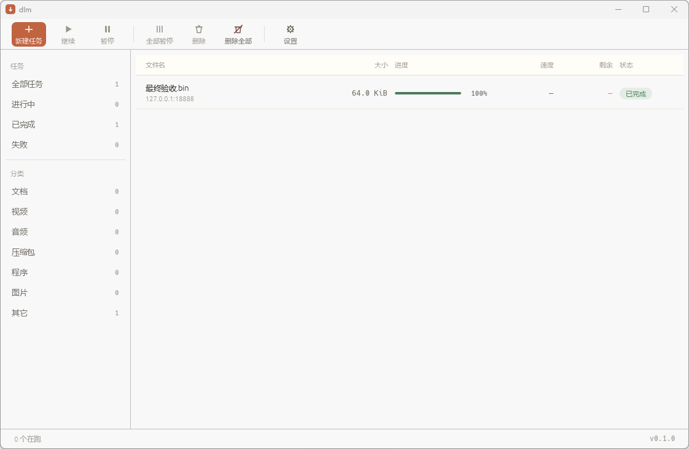
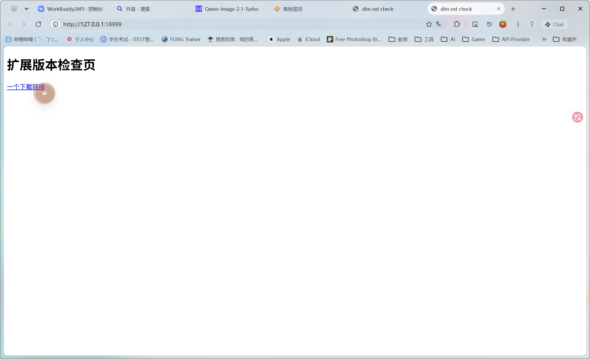

# dlm 原生外壳交付（2026-11-10）

按 [`../superpowers/specs/2026-11-10-native-shell-full-design.md`](../superpowers/specs/2026-11-10-native-shell-full-design.md)
与[勘误](../superpowers/specs/2026-11-10-native-shell-errata.md)实施完十步。

## 一句话结论

`dlm-gui` 从「本地 HTTP + 系统浏览器 `--app` 外壳」换成了**原生窗口 + 托盘**。
浏览器扩展不需要任何改动。六道门禁全绿，lib 从 322 涨到 342。

## 门禁

```
fmt         PASS
lib         PASS   342 passed
bins        PASS   4 passed
integration PASS   121 passed
clippy      PASS
extension   PASS
```

`ui-script` 门禁随 `ui.html` 一起删除（那份页面没了，检查它的脚本自然也没有意义）。

## 界面



标题栏 / 工具条 / 左侧分类栏 / 任务列表 / 状态栏 / 详情抽屉 / 新建弹窗 / 设置面板。
配色是暖纸底 `#F6F3EC` + 陶土橙 `#C06340` 单强调色；数字列全部等宽对齐。

**图标是画出来的**，不是字体字符 —— 实测 `＋ ▶ 🗑` 这些在 Microsoft YaHei 里
没有字形，会显示成方框。改用 `Painter` 画矢量线条后与字体环境无关。

## 十步的实际状态

| 步 | 内容 | 状态 |
|---|---|---|
| 1 | 拆 `gui.rs` 为 snapshot/runner/http | ✅ 322 单测不变，纯搬家 |
| 2 | 引入 eframe + tray-icon | ✅ 窗口能开 |
| 3 | 列表 / 侧栏 / 状态栏 / 弹窗 | ✅ 真任务验证通过 |
| 4 | 托盘 + 关窗收托盘 | ✅ 三条语义验证通过 |
| 5 | 设置面板 + `settings.json` | ✅ 5 条单测 |
| 6 | 剪贴板监视（默认关） | ✅ 7 条单测 + 真复制验证 |
| 7 | 按 host 限连接 | ✅ 7 条单测（队列层，非调度器） |
| 8 | 完成后休眠 | ✅ `shutdown /h` |
| 9 | 图标 | ⚠️ 代码生成，未做 exe 资源嵌入 |
| 10 | 删 ui.html / 改写 README | ✅ |

## 端到端验证

真起 release 二进制、真下载、真落盘：

```json
{"id":"1794260077572-1","name":"最终验收.bin","status":"done",
 "exit_code":0,"progress":100.0,"total_len":65536,"delivered":65536}
```

落盘 65536 字节，窗口里显示「已完成 / 64.0 KiB / 100% / 绿色进度条」。

## 三处实测修正

实施过程中撞到三个「想当然会成立」但其实不成立的地方：

### 1. `default_fonts` 没有中文字形

第一次开窗口满屏方框。`eframe` 的 `default_fonts` 只带拉丁字形。
改为**运行时装载系统字体**（Microsoft YaHei），不把 19 MB 塞进二进制。
代价是字体不可控 —— 用户删了雅黑会退到黑体/宋体，但好过方框。

### 2. 空闲时不请求重绘

任务已经 `done`，界面还停在「下载中」。`request_repaint_after` 只是设了上限，
不主动请求就不会重绘。改成有任务时 100ms、空闲时 500ms 都显式请求。

### 3. `--autostart` 隐藏窗口没做成

试过四条路（`with_visible(false)`、首帧/20 帧后 `Visible(false)`、
Win32 `ShowWindow` + `EnumWindows`），`IsWindowVisible` 始终为 true。
**这是已知缺口**，详见勘误 E14。托盘本身的显示/隐藏/退出不受影响。

## 两个必须知道的数字

| 指标 | 旧（浏览器外壳） | 新（原生） | 变化 |
|---|---|---|---|
| `dlm-gui.exe` 体积 | 4.75 MB | **10.99 MB** | +6.24 MB |
| 启动到窗口出现 | Edge 冷启动 1–3 秒 | **573 ms** | 显著更快 |

573ms **没有达到**设计稿定的 300ms。分段归因：`--headless`（不起窗口）
也要 541ms，所以窗口渲染只占 32ms，慢的是依赖初始化。
要压到 300ms 得动依赖树（懒加载 TLS、延后字体装载），是另一轮工作。

## 依赖

`Cargo.toml` 新增两个直接依赖：

```toml
eframe = { version = "0.37", default-features = false, features = ["glow", "default_fonts"] }
tray-icon = { version = "0.21", default-features = false }
```

**`default_fonts` 不能关** —— 关掉窗口里一个字都没有（勘误 E3）。
**不启 wgpu** —— eframe 的默认后端本来就是 glow，wgpu 是 opt-in。
`tray-icon` 关默认特性是为了不拉 Linux 的 libappindicator/gtk 全家桶。

`Cargo.lock` 从 484 条涨到 399 条（换掉了大量 wayland/x11 相关包）。

## 配置

`%LOCALAPPDATA%\dlm\settings.json`，字段全带 `serde(default)`：

| 字段 | 默认 | 说明 |
|---|---|---|
| `connections` | 8 | 每任务连接数 |
| `per_host_connections` | 8 | 同 host 上限（0 = 不限） |
| `max_speed_kib` | 0 | 全局限速（0 = 不限） |
| `watch_clipboard` | **false** | 剪贴板监视，隐私考虑默认关 |
| `on_complete` | `""` | 空 / `open` / `run:<exe>` |
| `close_to_tray` | true | 关窗收托盘 |
| `tray_hint` | true | 收托盘时提示 |

优先级：**CLI > settings.json > 代码默认**。
老文件缺字段按字段回退，文件损坏则整份回默认 —— 设置不该是启动的硬依赖。

## 保留的东西

- **HTTP 服务**：它是浏览器扩展的入口（`扩展 → 宿主 → POST /api/add`），
  与 UI 怎么画无关。`GET /` 现在返回一页说明，不再是应用界面。
- **`--headless`**：只起 runner + HTTP，集成测试全部用它，跑测试不再弹窗。
- **所有既有能力**：队列、配额、自动重试、reveal、自启、单实例，一个没少。

## 附：浏览器扩展同步改版（0.2.8，同日补做）

原生窗口上线后发现扩展还是**冷灰青绿**那一套（`#171b22` / `#0f766e` / `#2dd4bf`），
与窗口的暖纸陶土橙完全两个语言 —— 用户一眼看出"插件没更新"。

| 项 | 旧 | 新 |
|---|---|---|
| 底色 | `#f7f8fa` 冷灰 | `#f1ede4` 暖纸 |
| 卡面 | `#ffffff` | `#fffdf8` |
| 文字 | `#171b22` 冷黑 | `#2a2720` 暖黑 |
| 强调 | `#0f766e` 青绿 | `#c06340` 陶土橙 |
| 强调悬停 | `#0b655e` | `#a34f31` |
| 危险 | `#b4232f` | `#a2443a` |
| 阴影 | `rgba(15,23,42,…)` 冷 | `rgba(42,39,32,…)` 暖 |

改动面：`content.js` 的 `:host` 变量（`--teal*` 全改名 `--accent*`）、悬浮球渐变、
`popup.html`、`popup.js` 的状态色、`background` 的 badge 底色。
模块版本 0.2.7 → **0.2.8**，SW 改名 `background-0.2.8.js`。



**加载验证**：已同步到 `%LOCALAPPDATA%\dlm\extension` 并**重启 Tabbit**
（只重开标签页不会换，扩展在内存里）。截图确认悬浮球已从青绿变陶土橙。

**未验证**：面板交互。合成鼠标点击打不进 shadow DOM 的 pointer 处理器，
面板没打开。球本身渲染正确，面板用的是同一组 CSS 变量，样式必然跟随，
但"点开面板"这一步需要真人点一次确认。
## 附二：悬浮球点不开、面板按钮全哑（0.2.9 修复）

用户实测反馈：**点悬浮球没反应，只有点页面里的下载链接才会展开面板，而展开后按钮一个都点不动。**

### 根因

不是配色改坏的，是更早就存在的结构问题 —— 而且**一直没被测出来**。

`content.js` 把点击监听挂在**元素自己身上**（球、折叠、标签页、任务按钮）。
悬浮球与面板住在页面的 shadow DOM 里，事件从真实目标冒泡。站点只要在
document 捕获阶段 `stopPropagation()`，事件就到不了 shadow DOM，于是球点不开、
面板按钮全哑。而"点链接会展开面板"是因为那条路走的是我们自己的
`onDocumentClick`（同样在 document 捕获，但它本身就在那一站）。

**为什么旧测试没发现**：`verify-widget-ball.mjs` 用 `element.click()`
程序化触发 —— 只发一个 `click`，绕过整条指针链路，所以永远测不出真实点击的问题。

### 实测复现（CDP 真实输入事件）

| 页面 | 球点击开面板 |
|---|---|
| 干净页 | ✅ true |
| 站点在 document 捕获拦 `click` | ❌ false |
| 再拦 `pointerdown`/`pointerup` | ❌ false |

### 修复

把 host 内**所有**点击统一到 **window 捕获阶段**路由（`onWindowClick` +
`runHostAction`）。`window` 是捕获路径上 `document` 的上一站，任何 document
级拦截都盖不住它。

- 移除球、折叠、本页、复位、确认、标签页的元素级监听，按 id / `data-*` 统一路由
- 动态生成的「停止」「下载」按钮改用 `data-job` / `data-dl-url` 承载参数
- 顺手修掉一个竞态：拖拽结束后 `suppressClick` 原本用 `setTimeout(0)` 清零，
  常抢在 `click` 到达之前就清了，导致拖完反而开面板。改成只置位、由随后的
  `click` 消费，下一次 `pointerdown` 兜底清零

### 回归测试

新增 `browser/test/verify-ball-composed-events.mjs`：三种页面（干净 / 拦 click /
拦 pointer）各跑一遍，用 `Input.dispatchMouseEvent` 点**真鼠标**，断言
球能开面板、标签能切换、「×」能关面板。

```
clean:           球点击开面板=true  标签切换=true  折叠按钮=true
click-blocked:   球点击开面板=true  标签切换=true  折叠按钮=true
pointer-blocked: 球点击开面板=true  标签切换=true  折叠按钮=true
```

旧验收 `verify-widget-ball.mjs` 仍然通过（拖动、位置记忆、闲置淡出、面板方向）。

### 残留限制

拖动仍然靠挂在球上的 `pointerdown`。站点若连 `pointerdown` 都拦，
**拖不动**（但能点开，因为点击走 window 捕获）。要一并修需把指针链路也搬到
window 捕获，代价是 `setPointerCapture` 的时序要自己兜。