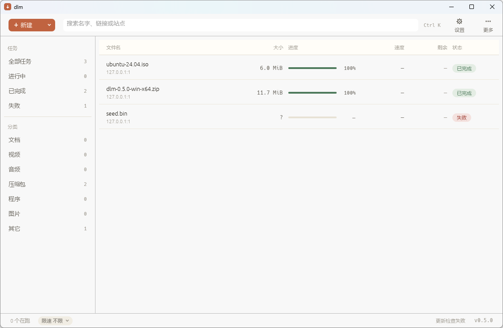

# 0.6.0 阶段 1 主界面改版（续）证据

> 2026-11-13 ~ 11-14。做的是计划里「阶段 1 剩余」那一整块：`⋯` 菜单、`＋新建▾`、状态栏限速。
> 上一轮这三件只做了一半就回退（作用域报错），这一轮一次改完再验证。

## 改了什么

| 位置 | 变化 |
|---|---|
| `src/gui/app/toolbar.rs` | 顶层只剩四样：`＋新建▾` / 搜索 / `⚙` / `⋯`。全部暂停、删除全部已完成收进 `⋯`；`＋新建▾` 里是单链接 / 批量粘贴 / 站点抓取 |
| `src/gui/app/context_bar.rs`（新） | 上下文动作条：选中任务才出现的一行（已选 · 名字 / 继续 / 暂停 / 删除 / Esc 提示） |
| `src/gui/app/icons.rs`（新） | 从工具条抽出的绘制图标（含新画的 `⋯` 三点与下拉箭头），工具条与动作条共用 |
| `src/gui/app/status.rs` | 状态栏加「限速 … ⌄」胶囊：点开常用档位 + 自定义，改完立刻作用于下一轮派发 |
| `src/gui/app/dialog.rs` | 「删除全部已完成」二次确认框（确认时**重算** id 列表） |
| `src/gui/app/shortcuts.rs` | `Ctrl K` 聚焦搜索（`Ctrl F` 继续认）、`Esc` 取消选择（有弹窗时归弹窗） |
| `src/gui/app/tray.rs` | `DLM_NO_TRAY`：门禁/用例里不建托盘图标 |
| `gates.ps1` | 与 `DLM_NO_UPDATE_CHECK` / `DLM_NO_SHELL_OPEN` / `DLM_NO_POPUP` 并列加上 `DLM_NO_TRAY=1` |

## 判据（计划里写的）

- 「现有 GUI 测试全绿」→ 门禁 6/6：`lib 456` / `bins 4` / `integration 122` / `clippy` / `fmt` / 扩展静态检查。
- 「新增『选中才显示动作条』的纯函数测试」→ `context_bar::task_actions_visible` 用例；
  另有 `pause_all_targets`（只碰在跑/排队）、`delete_all_targets`（只删已完成）、
  `delete_all_step`（永远先要确认）、`elide`（按字符截断）、`speed_limit_label`、`SPEED_PRESETS` 用例。
- 「`⋯` 里删除全部要二次确认」→ `delete_all_step` 用例 + 确认框在点确认时才重算 id。

## 截图实测：抓到两个自绘界面的真 bug



1. **`⋯` 被挤出窗口**：第一版搜索框按 `available_width - 104` 算宽，而右侧实际要占
   「Ctrl K 提示 46 + 两颗工具按钮 112 + 间距 22」。窗口 1684pt 宽时「更多」整个落在
   窗口外 —— 不报错、不 panic，只是那颗按钮用不了。改成扣 `RIGHT_SIDE_W` 常量后，
   1122pt 的窄窗口里四样东西也都在。
2. **`▾` 是空心方框**：状态栏胶囊里用了 `▾`（U+25BE），这台机器的 Microsoft YaHei
   没有这个字形 —— 与早年的 `＋ ▶ ❚❚ 🗑` 一模一样。改成用 `Painter` 画箭头：


## 没截到的部分（如实记）

上下文动作条与 `⋯`/限速两个菜单**没有截图**：本机的 agent-desktop 在 headless 策略下
拒绝对原生窗口做物理点击（`POLICY_DENIED`），而 egui 没开 accesskit、列表行不在可访问树里，
没有第二条"选中一条任务"的路。这部分目前的证据是：

- `gui::tests::a_whole_frame_renders_with_and_without_a_selection`：整帧各画一遍，
  选中态帧里的图元数量必须多于未选中态（挡住"条件写了、内容没画"的那种半实现）；
- 代码审阅：动作条的按钮与工具条用的是同一套 `icons::action_button`，图标绘制已在
  上面两张截图里验证过。

## 复现命令

```powershell
# 1) 门禁
powershell -NoProfile -ExecutionPolicy Bypass -File .\gates.ps1

# 2) 视觉核对（截图用的种子队列：2 个已完成 + 1 个失败）
$root = 'target\visual-stage1'
.\target\debug\dlm-gui.exe --port 47185 --queue "$root\queue.json" --out-dir "$root\dl" `
  --log-dir "$root\logs" --endpoint "$root\endpoint.json" --token visual3 --concurrency 2
```