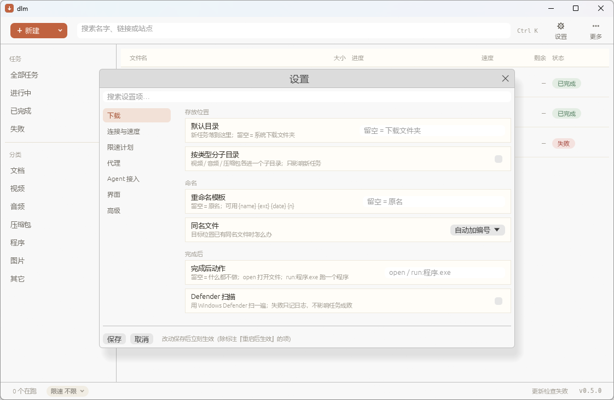

# 0.6.0 阶段 2 设置页改版证据

> 2026-11-14。判据（计划原文）：**每个设置项都有归属分类，无「其它」兜底**。

## 改了什么

| 位置 | 变化 |
|---|---|
| `src/gui/app/settings_spec.rs`（新） | 设置项的**目录表**：七个分类 / 分组 / 标题 / 一句解释 / 对应 `Settings` 字段名；`SettingKey` 枚举 + `search()` |
| `src/gui/app/settings_ui.rs` | 面板重写：顶部搜索、左侧七分类、右侧分组卡片、每行「标题 + 一句解释 + 控件」；新增「Agent 接入」页 |
| `src/gui/settings.rs` | 新增 `agent_confirm`（Agent 下发前要不要问人，默认开） |
| `src/gui/app/shortcuts.rs` | `Ctrl+,` 与 `Ctrl+Alt+S` 打开设置（两种习惯都认） |
| `src/gui/app/drawer.rs` | 抽屉关闭按钮 `✕`→`×`（前者字体里没有字形，见下） |

## 判据怎么落的

两条**机械**判据，都不靠人盯：

1. `settings_spec::tests::every_settings_field_has_exactly_one_spec` ——
   拿 `serde_json::to_value(Settings::default())` 的键集合跟表里的 `field` 集合对账：
   缺一条就是"界面上神秘消失的设置项"，多一条就是拼错了字段名。
   （手抄清单不可靠：清单和结构体一起漏掉同一个字段时，谁都发现不了。）
2. `settings_ui::setting_control` 是对 `SettingKey` 的**穷举 `match`** ——
   加了设置项却忘了画控件，编译就红。

再加一条覆盖：`gui::tests::every_settings_page_renders` 把七个分类 + 搜索态 + Agent 页
各渲染一帧（`run_ui`），挡住"某一页一打开就 panic"。

门禁 6/6：`lib 466` / `bins 4` / `integration 122` / `clippy` / `fmt` / 扩展。

## 截图



左列七个分类（下载 / 连接与速度 / 限速计划 / 代理 / Agent 接入 / 界面 / 高级），
右侧「存放位置 / 命名 / 完成后」三张卡片，每行左标题右解释、右侧控件。

## 截图又抓到一类 bug：字体缺字形


限速菜单里用 `✓` 标当前档位，画出来是个**空心方框** —— 与阶段 1 的 `▾`、更早的
`＋ ▶ 🗑` 同一个坑。这台机器的 Microsoft YaHei 缺 `▾ ✓ ✕ ⋯ ＋ ▶` 这批字形。

修法不再靠"下次注意"，改成一条用例：
`gui::tests::every_symbol_we_put_in_the_ui_has_a_glyph` 把界面里**真要画出去的符号**
列清楚，逐个问字体表（`ctx.fonts_mut(|f| f.has_glyph(...))`），缺一个就红并指名道姓。
它当场又抓出抽屉关闭按钮的 `✕`（已换成 `×`）。

> 这条用例也解释了为什么图标是"画"出来的：`icons::draw_icon` 不依赖任何字体。

## 没截到的部分（如实记）

- **Agent 接入页**没有截图：本机 agent-desktop 在 headless 策略下不能物理点击，
  而当前二进制没开 eframe 的 `accesskit` 特性，egui 控件不在可访问树里 ⇒ 没有
  "切到另一页"的键盘/语义入口。该页目前的证据是 `every_settings_page_renders`
  （渲染不 panic）+ `mcp_available` 的单测（没装 dlm-mcp 时复制按钮置灰）。
- 顺带发现：**打开 `accesskit` 特性**能同时解决"屏幕阅读器可用"与"整机 UI 自动化"，
  是 0.6.0 之后值得单独立项的一件事（要动依赖，需用户点头）。

## 复现

```powershell
powershell -NoProfile -ExecutionPolicy Bypass -File .\gates.ps1
# 手动看：启动 GUI 后按 Ctrl+, 或 Ctrl+Alt+S
```