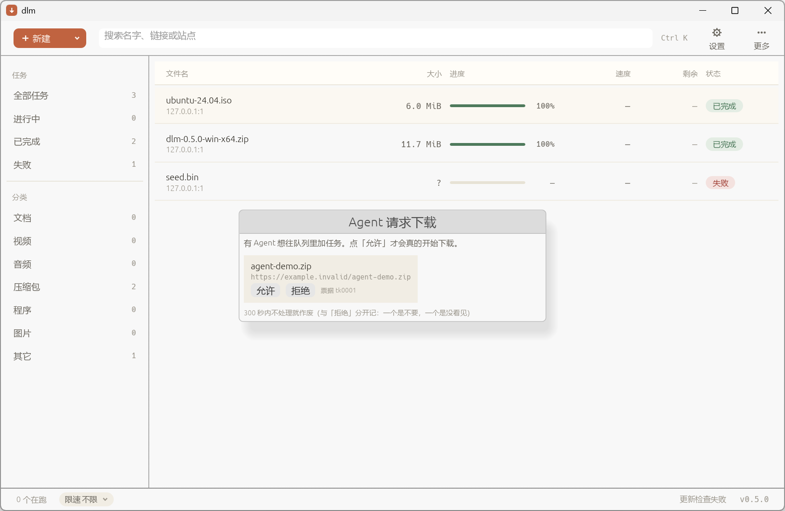

# 0.6.0 阶段 3/4/5 证据

> 2026-11-14。这一段是计划的收尾三块：抓取窗口改版、特色功能（夜间批次 / 命令面板 /
> 卡顿诊断）、Agent 接入闭环。每个阶段单独提交，门禁逐次全绿。

## 总览

| 阶段 | 提交 | 判据 | 结果 |
|---|---|---|---|
| 3 抓取窗口 | `9e1e904` | 清单列（勾选·文件名+来源页·类型·来自·大小）、已去重不可勾选、无勾选时入队禁用、模板按站点记 | ✅ |
| 4-1 夜间批次 | `6492bef` | 限速窗口 + 队列编排 + 跑完关机合成一个开关 | ✅ |
| 4-2 规则界面 | `fb58586` | 增删改 + 顺序即可排序（上移/下移） | ✅ |
| 4-3 命令面板 | `e8a5b5c` | `Ctrl K`，英文命令 + 中文解释 | ✅ |
| 4-4 卡顿诊断 | `253bfd1` | 每任务速度曲线 + 「重试 N 次 / 卡住 M 秒」 | ✅ |
| 5 Agent 闭环 | 见下 | 控制口票据 + `dlm-mcp` + 确认开关 | ✅ |

最终门禁：`fmt` / `lib 502` / `bins 11` / `integration 123` / `clippy` / 扩展静态检查 —— 全绿。

## 阶段 5：Agent 接入闭环



这张图是**真的**：向运行中的 `dlm-gui` 发一条
`POST /api/agent/add {"url":"https://example.invalid/agent-demo.zip","name":"agent-demo.zip"}`，
下一帧确认框自己弹出来，队列仍然是 3 个任务（没有多出来）。

同一时刻的接口实测：

```
/api/tasks                       → 3 个任务（票据挂着时一个都没多）
/api/agent/ticket?id=tk0001      → {"ok":true,"state":{"state":"pending_approval"}}
/api/agent/ticket?id=tk9999      → {"ok":false,"error":"没有这张票据（…）"}
```

### 三层各管一件事

| 层 | 干什么 | 为什么这样分 |
|---|---|---|
| `dlm-mcp`（新二进制） | stdio JSON-RPC，4 个工具：`dlm_add` / `dlm_ticket` / `dlm_list` / `dlm_status` | 只是控制口的转发器；自己找 `endpoint.json`，用户不用抄 token |
| 控制口（`dlm-gui` 的 127.0.0.1 + token） | 唯一的队列写入入口 | 队列只有一个写入者（runner），MCP 与界面都不碰队列文件 |
| 票据（`gui/tickets.rs`） | `pending_approval → approved / rejected / expired` | 本地控制口挡得住别的机器，**挡不住本机的 Agent** |

### 票据的几条规矩（都在 `tickets.rs` 与 `agent_ui.rs` 里写明）

- **5 分钟作废**，且「过期」与「拒绝」分开记 —— 一个是我不要，一个是我没看见。
- **同一张票据只许建一个任务**（重复批准返回 false），否则点两下就下两份。
- 批准后**先等 runner 回执**再写 `Approved{task_id}`：Agent 在轮询这个状态，
  提前置成 approved 会让它拿到一个不存在的任务 id。
- 建任务失败 ⇒ 当拒绝处理，给 Agent 一个终态，别让它无限等。

### 一个只有集成测试能抓到的坑

闸门的初值本来只由 UI 帧同步（`sync_agent_gate`）。`--headless` 没有 UI 帧 ⇒
确认开关永远是关的，Agent 直接就把任务加进去了。集成用例
`gui_agent_add_waits_for_a_ticket_instead_of_enqueueing` 第一次跑就红了，
现在改成**启动时也从 settings 读一次**。

## 阶段 4 的三个功能，各留一条"为什么不做得更花哨"

- **夜间批次**：窗口外只拦**新派发**，已经在跑的不掐断 —— 到点了把用户下到 90% 的任务
  停掉不是编排，是事故。窗口内的限速**不叠加**限速计划（两个都生效会得出解释不清的数）。
- **命令面板**：`Ctrl K` 从"聚焦搜索"升级成面板，面板第一项就是「搜索任务」；
  `Ctrl F` 原样保留。命中为空时选中下标夹回 0，否则回车会执行"看不见的那条"。
- **卡顿诊断**：只看"有没有新字节"，不看速率大小 —— 限速到 1 KiB/s 的任务在动，不算卡住。
  曲线纵轴按这批点的最大值归一，比的是它自己相对自己。

## 阶段 3 的两处"做不到就不画"

- **大小列恒为「—」**：扫描只读 HTML、不发 HEAD，这一刻真不知道多大。挂个假数字更糟。
- **扫描进度是"转圈 + 已用时"**：`grab::scan` 是一次阻塞 BFS，中途拿不到"还剩几页"。

## 没截到图的部分（如实记）

- 命令面板、抓取窗口、设置页的「高级/限速计划」页：本机 agent-desktop 在 headless
  策略下不能物理点击（`Ctrl K` 也打不进去，窗口拿不到前台），二进制又没开 eframe 的
  `accesskit` 特性 ⇒ 控件不在可访问树里，没有语义入口。
  这些界面的证据是整帧渲染用例：`the_command_palette_renders_in_all_three_states`、
  `the_grab_window_renders_a_plan_with_duplicates_and_skips`、`every_settings_page_renders`。
- 想补上这一块，需要给 eframe 开 `accesskit` 特性（要动依赖，等用户点头）。

## 复现

```powershell
powershell -NoProfile -ExecutionPolicy Bypass -File .\gates.ps1

# Agent 闭环手工验：
#   1. 启动 dlm-gui（记下 --port 与 --token）
#   2. curl -X POST "http://127.0.0.1:<port>/api/agent/add?t=<token>" -d '{"url":"https://example.invalid/a.zip","name":"a.zip"}'
#   3. 界面弹出「Agent 请求下载」，此时队列不变
#   4. curl "http://127.0.0.1:<port>/api/agent/ticket?t=<token>&id=tk0001"
```