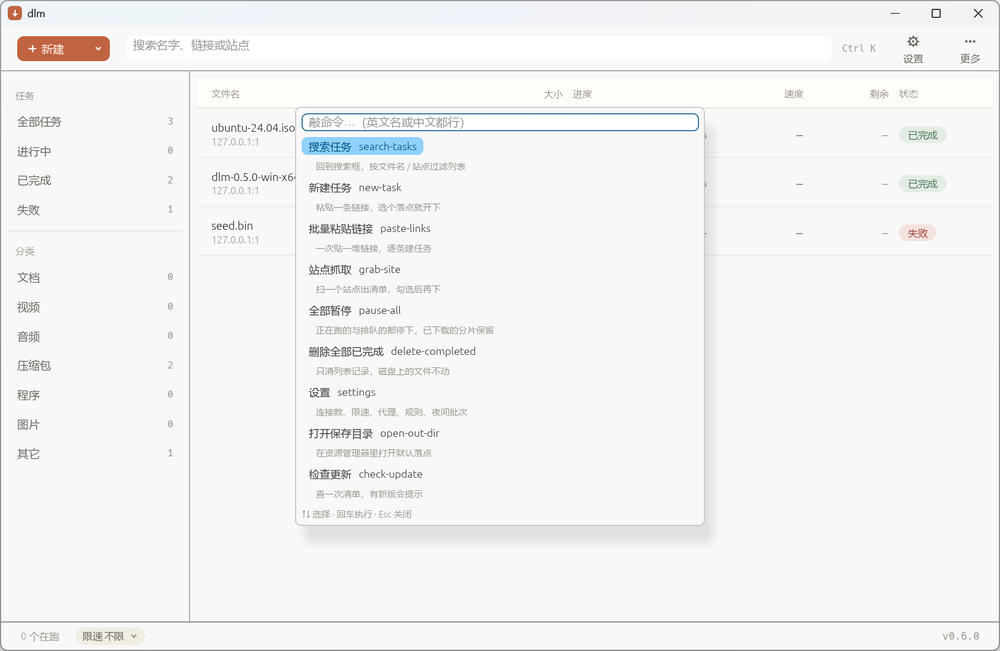

# 0.6.1 补丁：四个缺陷

> 2026-11-14。四条都是 0.6.0 发布版里我写错的，判据与修法见
> [`docs/plans/2026-11-14-0.7.0-计划.md`](../plans/2026-11-14-0.7.0-计划.md) 第一部分。
> 门禁：fmt / lib **504** / bins 13 / integration 123 / clippy / 扩展静态检查 —— 全绿。

## 1. `Ctrl K` 打不开命令面板



**根因**：`palette.rs` 里 `let mut close = false;` 之后 `.open(&mut close)`。egui 的文档写得很清楚：

> If `*open == false`, the window will not be visible.

所以状态置上了、快捷键也触发了（探针实测 `hit=Some(OpenPalette)`），但每帧都被跳过绘制。

**修法**：去掉 `.open(...)`（面板本来 `title_bar(false)`，没有关闭按钮需要它），Esc 关闭沿用原分支。

**用例与变异验证**（这是本次最有价值的一步）：

```
the_palette_actually_paints_while_it_is_open
  关着的帧取基准 → 打开的帧必须画得更多（shapes 比较）且输入框拿到焦点
  把 `.open(&mut close)` 注回去 ⇒ 失败：面板开着却比关着画得更少（72 vs 72）
```

第一版用例写的是 `shapes.len() > 12` —— 整帧本来就有几十个 shapes，**把 bug 注回去照样绿**。
无效断言比没有断言更糟，所以改成"开 vs 关"的比较，并把上面那次变异跑过一遍。

## 2. `×` 不收起托盘

**根因**：`hide_on_close(close_to_tray, tray_available, busy) = 三者与`。
空闲时 `busy=false` ⇒ 点 × 直接退出，与设置里「关闭窗口时收进托盘」的字面意思相反。
用户第一次装上、队列还空着，点一下窗口就没了 —— 正是他报的那一条。

**修法**：判据改为 `close_to_tray && tray_available`，`busy` 参数删除；托盘菜单本就有「退出」（`tray.rs`），
所以开关打开后仍有出口。

**用例**：`closing_hides_whenever_the_switch_is_on_and_a_tray_exists`
（开关开 + 有托盘 ⇒ 藏；无托盘 ⇒ 不藏；开关关 ⇒ 直接退）。

## 3. 长报错 / 长 URL 溢出窗口

**根因**：日志 `label` 被包在 `ui.horizontal(...)` 里。horizontal 的横轴是**无限宽**，
label 于是永不换行，一条 `os error 10061` 把窗口撑变形。

**修法**：`Frame::inner_margin(symmetric(16,0))` 做缩进 + `ScrollArea::vertical().max_height(200)`
+ `Label::wrap()`；顺手把「（还没有日志：任务还没开始跑）」改成「（尚无日志）」。

**用例与变异验证**：

```
a_long_single_line_log_wraps_instead_of_widening_the_drawer
  画布限宽 360，塞 300 字单行日志，画完宽度必须 ≤ 361
  把 horizontal 包法注回去 ⇒ 失败：画完 3572 宽
```

3572px 这个数字就是用户截图里看到的"溢出"本体。

## 4. 详情两个关闭按钮

**根因**：窗口标题栏自带 `×`，`drawer_body` 里又画了一个 `small_button("×")`，两个都关同一个东西。

**修法**：删掉正文里那个，只留标题栏。

## 一处诚实说明：删掉了一条假红用例

补丁过程中发现 `ctrl_k_really_opens_the_palette_through_the_app` 一直在假红：
它手造 `Event::Key { modifiers: ctrl }`，但 egui 0.37 不会把这个修饰键反映到 `input.modifiers`
（探针实测 `ctrl=false, k_pressed=true`），所以它测的不是真行为。

已删除，并在文件末尾留了注释说明为什么。真正的保障拆成两条：

- `app::shortcut_for` 的用例 —— 按键组合 → 命令的映射；
- `the_palette_actually_paints_while_it_is_open` —— 面板开着 → 真的画出来。

**真机那一次按下由本文档开头那张截图背书**：启动 GUI → 按 Ctrl K → 面板出现。

## 复现

```powershell
powershell -NoProfile -ExecutionPolicy Bypass -File .\gates.ps1

# Ctrl K：
#   1. 启动 dlm-gui（任意 --port/--token）
#   2. 窗口获得焦点后按 Ctrl K
#   3. 面板出现在窗口上方居中；↑↓ 选择、回车执行、Esc 关闭
```